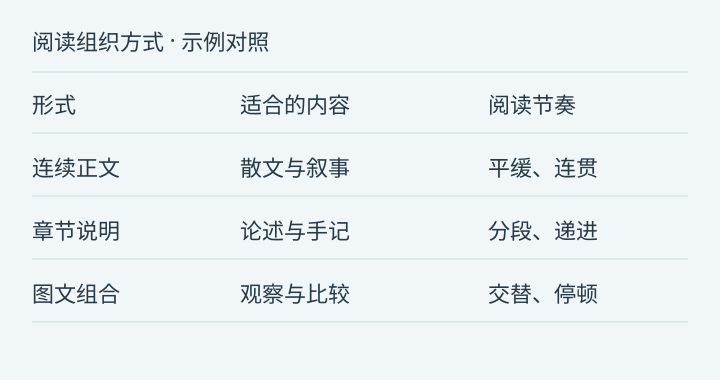

---
{
  "title": "在纸面与屏幕之间：一份图文混排的阅读观察",
  "slug": "editorial-visual",
  "description": "图片、图注、引文、结构化比较与长文的组合。",
  "tags": [
    "layout-preview"
  ],
  "collections": [
    "editorial-preview"
  ],
  "published_at": "2026-10-14T08:02:00+08:00"
}
---

### 本文要点

1. **图片作为阅读停顿**横幅与图注组成一个完整的观看单元。
2. **比较进入同一视野**原创矢量对照图与正文交替出现，展示多种阅读组织方式。
3. **在不同屏幕上成立**长标题、图片、列表与密集段落共同检验视觉层级。

这是一篇原创图文排版示例。图像由本地矢量绘制，用于观察大图、图注、段落与列表之间的距离，不代表实际产品数据。

## 一、图片可以是一个停顿

在长篇文章里，图片并不一定承担解释全部信息的责任。它也可以让读者暂时离开连续的句子，重新观察一种颜色、一个空间或一个关系。当图片的宽度与正文保持一致，页面会显得连贯；当图片拥有不同的比例，读者又会感到一次明确的节奏变化。

*图 1：横向插图与正文同列，留白让阅读从文字过渡到图像。所有图形均为本地原创示意。*

图注提供的是观看的入口。它应该比正文安静，但不能小到需要放大才能阅读。一张图片究竟展示什么、来自哪里、哪些部分只是示意，都可以在图注里说明。这样，读者既可以快速略过，也可以在有兴趣时获得更多上下文。

### 图像与解释之间

如果每一张图片后面都立即跟着一个新标题，页面会被切成许多互不相关的小段。相反，在图像之后保留一两段解释，往往能让视觉材料重新进入文章的叙事。读者先看见，再理解，最后才进入下一个问题。

这也是为什么图注与正文不应该完全采用同一种视觉重量。图注负责指认，正文负责展开，两者共同组成一个完整的阅读单元。

## 二、把比较放在同一个视野里

下面这张对照图展示三种虚构的阅读组织方式。数值与标签都不是业务指标，而是方便观察排版的说明。

*图 2：结构化比较图。在当前 Markdown 组件未支持原生表格时，以清晰的矢量图呈现比较，不扩展内容协议。*

**连续正文**适合叙事：它依靠句子之间的连接推动阅读。**章节说明**适合论述：标题让读者知道每一步在回答什么问题。**图文组合**适合观察：图像提供证据或空间，文字为它补充语境。

这里没有一个适用于全部内容的选择。同一篇文章也可能依次使用三种方式。排版应该为内容留出变化的空间，而不是要求所有文章都拥有相同数量的标题、图片和摘要。

> 视觉层级不是装饰的多少，而是读者能否判断：什么是主线，什么是补充，以及下一步应该看向哪里。

## 三、让信息在不同尺度上成立

桌面屏幕给了我们更多横向空间，手机则让每一次换行都更加明显。一个在桌面上只有两行的标题，到手机上可能变成四行；一张宽阔的图，在手机上可能只剩下一个很小的整体轮廓。

因此，长文的移动端体验不只是把容器缩窄。段落的行高、图片里文字的大小、标题的自然换行，都需要放到真实页面里观察。一个很简单的判断是：读者是否需要不断放大，才能知道自己正在看什么。

### 一个观察清单

1. 标题：长标题能否自然换行，是否压住了日期和说明。
2. 正文：连续读完三段之后，视线是否仍然容易找到下一行。
3. 图片：重要细节是否可见，图片说明是否足够清楚。
4. 结构：从一个章节进入下一章节时，是否有明确但不过分的停顿。
5. 结束：最后一段之后是否能够继续阅读，还是突然进入另一种界面。

这份清单不追求每次得到相同的答案。不同的文章有不同的材料，不同的读者也有不同的速度。重要的是，把真实内容放进去，再观察它是否仍然成立。

## 四、一段更密集的文字

我们常常在短样例里判断一个页面是否漂亮：一个标题，两段正文，一张封面。这样的判断有价值，但它只能看到局部。当文章延伸到多个章节，连续出现引用、图片与列表时，原先没有被注意到的问题才会逐渐显现。过大的段落间距会让内容松散，过小的章节留白会让主题混在一起，重复的边框可能让每个段落都像一张独立卡片。长文提供了一次更诚实的观察机会，因为读者需要真正经过这些结构，而不是只看它们摆在一起的样子。

我们也不必急着为所有问题增加一个新组件。有时候，只要把正文行宽稍微收窄，把章节间距拉开，把图注的字号调小一点，页面就已经清楚许多。简单的规则并不意味着粗糙；当规则能够在不同内容里持续成立，它们反而更容易形成稳定的气质。

## 五、回到文字本身

最后这一节没有图片，也没有特别的强调。它用来观察，经过几次图文交替之后，纯文字是否仍然让人愿意读下去。

好的阅读排版会让设计逐渐退到背景里。读者先注意到文章在说什么，然后才在停下来时意识到，这个页面读起来很舒服。我们希望这几篇示例能够提供足够多的组合，让你找到适合自己内容的节奏。