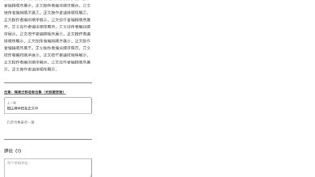

# Issue #18 独立 review 与现场验收

结论：本次有界验收 PASS，未发现尚未修复的阻断项。该结论来自隔离环境中的实际发布、迁移、登录、正文/评论/媒体交互、引用变更及 SQL/字节对照；不表示生产部署、真实 OSS 网络或全部并发组合已验证。

## 版本范围

- 旧合同及旧数据来源：评论交付分支 `70d6dd52be833ae7f55f344e1b22783cbf8a0ae2`，基准 main `24000316eb49dfdc9f66f4f3688b257a037eadda`。
- 正式 0010 迁移与核心业务矩阵：`69344c7311f7630eb7a2d39ac6573593f99864f7`。实际执行 SQL 0000–0010 及应用回填，没有使用 drizzle push。
- 旧 frontmatter.media 拒绝：CLI 构建于 `79780e15ea8952c05ffe529935a868d539c029f5`，完成真实失败及既有数据不变回执。
- 最终整合源码：`221ecf05aedc7bce80a18fb992c4045e2572583d`，加入独立合集导航。最终完整构建、类型检查及浏览器抽验时 HEAD 为 `06591b06c24d81bc80b36336d34c03a0b40b9d20`；后者仅追加文档，`apps/`、`packages/` 对前者无差异。源码与构建输出哈希分别见 `source-final-sha256.json`、`runtime-final-sha256.json`。
- 最后已重启 API4461，运行最终构建的 `apps/api/dist/index.js`；Web3161 已停止旧进程并从最终构建启动。最后编译版 API 回执见 `final-compiled-api-smoke.json`。
- 最终合并 main 后续审：`162919403b10760f6dd06be5cab17d255d65cb59`。相对06591b0仅五个API文件调整中间件作用域及身份线private/no-store默认值；没有改变已验迁移、正文或引用逻辑。主代理在本隔离配置执行最终typecheck/build均exit0，日志 `typecheck-integration-1629194.txt`、`build-integration-1629194.txt`。reviewer重启该版本编译API与前端，并完成下述差异现场抽验。最终准确源码与运行bundle哈希见 `source-integration-1629194-sha256.json`、`runtime-integration-1629194-sha256.json`。
- `review-initial.md`、`review-followup.md` 是中间 review 历史，不是当前结论。followup 中16篇、16次 view与旧备份 hash对应较早准备阶段；最终增加“原主媒体已在正文中”一篇，正式迁移前17篇及17次历史 view。最终备份 SHA256 为 `4996f6d4ec1e0240ff62c9a9e0b1965f32e6dd40eca66a511528828762bb77b3`。

## 环境与数据前提

独占 PG `127.0.0.1:55461`；主库 `yoryon_post_review`，附加空库 `yoryon_post_empty`、故障库 `yoryon_post_missing`、备份恢复库 `yoryon_post_restore`。目录 `/tmp/yoryon-post-article-review-20261013` 权限700，配置 `env.sh` 与凭据/会话 JSON 权限600，均留在工件外。独占 FS 媒体位于该目录的 `media/`。API4461、Web `http://localhost:3161`，BFF/FS/cache 随机本地密钥；SMTP127.0.0.1:1，无监听，不发邮件。没有读取或修改生产业务库，也没有使用主代理 PG55459/API4459。

实际作者输入经旧版及新版 CLI 发布。旧 image/video/audio 各覆盖 public、paid percent20、marker、full；article同样四种配置，另有原正文已经呈现主图片的作品。公开/付费主媒体分别产生不同字节，避免内容寻址共享造成权限前提误判。冻结作者输入只作为历史证据，位于 `frozen-legacy-author-input/`、`frozen-new-author-input/`，不是固定 fixture、harness 或执行测试入口；哈希见 `frozen-input-final-sha256.json`。

新账号仅在本库建立 active 用户并使用真实登录接口及浏览器 LoginForm：普通用户、会员、管理员，公开资料见 `account-preconditions.json`。会员由实际 CLI grant 获得订阅。到期边界通过仅修改自身权益 valid_from/valid_until 到过去建立前提；随后实际重新 grant，并用实际 CLI revoke 验证撤销。注册/邮箱验证不是本次路径。

内置浏览器新建隔离标签，使用 localhost host-only Cookie，与另一 reviewer 的127.0.0.1:3160分离；未操作用户日常浏览器。手机视口390×844，仅作用此标签；网络阻断/拦截与视口临时设置已恢复。

## 迁移与恢复的实际结果

| 路径 | 实际结果 | 证据 |
| --- | --- | --- |
| 原0000–0005应用迁移、旧CLI发布、置顶与统计 | 建立17篇旧数据、17次历史view；保留原DTO及SQL关联 | `legacy-*.json`、`legacy-*-cli*.txt` |
| 0010 SQL后、应用回填前中断 | 类型转换，预览NULL；匿名paid正文为空、DTO不含付费主媒体 | `migration-sql-stage.txt`、`migration-null-phase.json` |
| 回填前暖缓存 | 同一空预览render地址实际MISS→HIT；没有私有正文 | `migration-null-warm.json` |
| 正式 `pnpm db:migrate` 应用回填 | 旧ID/slug/title/description/visibility/preview规则/cover/发布时间/创建时间/置顶保留；原正文后缀保留；旧主媒体仅注入一次，原正文已有主媒体不重复 | `migration-application-69344c7.txt`、`migration-exact-comparison.json` |
| 旧付费预览精确对照 | 三媒体类型×percent/marker/full，以及article paid三模式，匿名 Markdown 与旧API逐字符串相同；媒体percent原328字仍328字 | `migration-exact-comparison.json` |
| 字节与历史关系 | 允许读取的旧媒体SHA256不变；三个paid主媒体匿名403；7类关联/媒体/合集/标签/历史统计表hash完全相同 | `migration-exact-comparison.json`、`legacy-anonymous-media.json` |
| 缓存恢复 | 原暖空预览UUID立即404；canonical详情包含原预览且无私有探针；完成后的回填重跑不再轮换revision | `migration-exact-comparison.json`、`migration-idempotence-and-control-analytics.json` |
| 空库正式迁移 | 11条迁移，contents为空，待回填投影为0 | `migration-empty-db.txt`、`migration-empty-and-restore.json` |
| 缺主媒体的旧库 | 预期P0001明确失败；SQL/DDL事务回滚，仍6条迁移、四旧类型，新引用/备份表与预览列没有留下 | `migration-missing-primary.txt`、`migration-missing-rollback.txt` |
| 备份恢复 | 恢复上述最终17篇备份到独立旧库；每篇原字段一致、仍6条旧迁移；7类历史关联hash一致 | `restore-backup-cli.txt`、`migration-empty-and-restore.json`、`restore-relations.json` |
| 合集元信息变更 | 实际CLI更新合集；12篇旧paid成员revision轮换、previewRevision对齐，公开预览仍逐字符串相同 | `collection-preview-carry.json`、对应CLI回执 |

## 发布、引用、权限与缓存

新CLI实际发布无标题纯文本post、混合图文视频音频post、长文article、paid marker post、多个引用父级及间接引用者。发布与变更日志中的cache事件已经实际 verified，见 `post-publish-cli.txt`、`reference-publish-cli.txt`、`reference-lifecycle-cli.txt`。

- 旧frontmatter.media、自引用、缺失UUID、非法UUID以及超过20个不同引用：均预期退出1并给出明确原因；已有作品整行与引用关系SHA256逐次相同。`publish-rejections.json`、`publish-rejections-cli.txt`。
- post↔post循环能发布；公开卡片summary排除引用指令，不递归加载。引用article呈现标题/摘要，引用paid post只读匿名投影，即使请求携带会员身份也没有私有正文。`permission-api.json`、`reference-lifecycle.json`、`browser-reference-dom.txt`。
- 暖父级render MISS→HIT后，修改目标轮换直接父级版本，旧render404；paid父级预览carry且版本对齐；间接父级版本不变。收紧为paid none后summary为空、media为null；下架与删除404；删除保留referenced_id、target_id置NULL；同slug重建得到新ID，旧引用仍不可用。`reference-lifecycle.json`。
- 仅在本库SQL修改paid正文与规则，再实际 `cache refresh`：父级版本轮换，mismatch公开投影重算为空，详情/卡片均未包含新私有探针。随后用作者目录正常重新发布恢复数据。`reference-lifecycle.json`。
- 匿名、普通用户：paid详情只有公开预览，评论写入401/403。会员/管理员：完整正文及paid媒体、canInteract=true；私有详情与权益媒体302为no-store。有效会员实际读取视频/音频SHA256匹配内容地址，Range 0–31为206/32字节。到期与撤销后新详情恢复preview、媒体403、互动403。`permission-api.json`、`media-and-expired-permissions.json`、`revocation-and-shared-html.json`。
- 匿名请求免费首页、订阅页、付费详情、引用详情：HTML没有两类私有探针。该检查覆盖服务输出与已验证匿名DTO，未把成员DOM中可见私有正文当成泄露。`revocation-and-shared-html.json`。

## 浏览器最终可见结果

- 免费首页只含免费作品；article只呈标题/简介；post正文按作者顺序呈现，原地展开/收起保留URL。图片对话框可用键盘打开、Escape关闭且焦点返回按钮。`browser-home-folded.png`、`browser-expanded-dom.txt`、`browser-image-dialog.png`、`browser-collapsed.png`。
- video和audio真正创建播放器，readyState4、2秒时长、无媒体error；键盘Play后paused=false。切换音频时video卸载，停止后无播放器；手机首页播放器离屏后也卸载。控件在ready DOM中有Play/Mute/设置等标签。`browser-video-*.json`、`browser-audio-playing.json`、`browser-media-stopped.json`、`browser-player-offscreen.json`。
- 展开、图片预览、播放、停止、收起没有新增work click/view/read，SQL仅记录原1次impression。`migration-idempotence-and-control-analytics.json`。
- 仅阻断一个正文资源请求，达到请求截止后原预览仍在，出现失败/重试；移除拦截后实际点击重试重新展开。`browser-expand-failure.txt`、`browser-expand-retry.png`。这是请求悬挂/超时验收；未成功注入503响应，不能声称503专门验收通过。
- 早期引用资源阻断出现错误提示，解除后自动重新获取卡片；当时手动重试回执未取得，保留失败DOM和实际工具失败，没有把自动恢复当手动成功。**最终1629194补验手动重试PASS**：新独占标签上先阻断该引用资源，错误DOM出现后用Shift仅聚焦“重试”，核对activeElement文本为“重试”；移除资源阻断后对已聚焦按钮发送Return。唯一一次引用GET的发起栈明确含 `onClick`，随后200，卡片恢复。见 `browser-integration-retry-before.txt`、`browser-integration-manual-reference-retry.json/png`。此记录替代先前的UNVERIFIED结论。
- 会员真实登录→订阅预览→paid帖子完整正文→实际发表评论。到期后手机详情只剩公开段、锁定提示和原公开评论，新增输入/回复入口消失，点击受限点赞未写入，SQLlike_count=0。`browser-member-feed.txt`、`browser-member-comment.png`、`browser-expired-mobile.png`、`expired-like-sql.json`。
- 最终06591b0构建：普通账号再次真实登录；合集首篇无上一篇，中间两侧有邻居，末篇无下一篇；实际点击下一篇落到对应文章，导航数据与SQL排序一致。无标题post及article真实评论均保存，SQL作者为普通账号。`final-navigation-api.json`、`browser-final-nav-*.txt/png`、`browser-final-post-comment.png`、`browser-final-article-comment.png`、`final-compiled-api-smoke.json`。
- 最终构建引用旧删除目标显示不可用；paid公开图片可原地预览；实际引用链接落到长文及其已保存评论。手机宽度scrollWidth=390，没有横向溢出。`browser-final-reference-image.png`、`browser-final-reference-navigation.json`、`browser-reference-mobile.png`。
- 1629194作用域差异：公开feed/paid-feed/detail/comments保留public缓存语义，携带admin身份的公开paid详情仍是preview且无私有探针；私有详情full/context以及身份401/404都为private/no-store。197301字节的有效PNG头像实际上传成功，字节读取为320×320 WebP，随后删除头像；大于2MiB头像及大于32KiB问答各明确413，证明问答限制不再误覆盖头像。一次Undici对超大请求体遇到early-close，换成逐响应HTTP请求取得实际413，未误报源码失败。`integration-1629194-api.json`。
- 1629194浏览器再次确认普通账号paid详情没有私有正文/新增评论输入；无标题post与article的原评论可见、输入正常，实际点击合集上一篇落到对应作品。`browser-integration-paid-locked.txt`、`browser-integration-post.txt`、`browser-integration-navigation.json`、`browser-integration-article.png`。

## 检查与边界

完整 `NODE_ENV=production pnpm build` 与随后 `pnpm typecheck` 均exit0：核心69344c7和最终06591b0分别有独立日志。第一次构建误继承development导致Next `<Html>`错误，保留失败日志 `build-69344c7.txt`；明确NODE_ENV后完整构建成功，该失败不算源码缺陷。CI状态/PR合并由主代理核对，本报告没有把本地构建称为CI或业务全覆盖。

本轮未做生产部署、真实OSS/目标网络、注册发邮件、所有媒体格式、所有浏览器引擎、超过100直接引用者的业务恢复操作，或迁移/发布/GC全部竞态组合；相关静态事务与锁设计已审查，未验证部分仍UNVERIFIED。备份恢复证明SQL及关联还原，没有从恢复库启动旧API再走一遍浏览器。

初次review曾把textPrefix算作#18新增宽松预览；复核实际main24000316后确认基准本来已有该行为，已撤回，不列为缺陷。实际付费主媒体prepend改变旧percent边界的问题已由统一持久投影解决并现场确认。

## 安全与收尾

工件对本次全部已知配置密钥、随机密码、API会话及JWT/签名URL模式扫描无命中，见 `artifact-safety.json`；公开用户记录不含密码hash，网络回执仅保留方法/路径，媒体工件只留hash/字节状态。

已按主代理要求停止本代理的旧评论API4323/Web3103；没有停止原e2e容器或删除r5资料。独占环境曾按要求保留供最后整合，历史状态见 `environment-hold.json`。1629194抽验后主代理明确授权清理；最终数据库删除、PG/API/Web停止、临时媒体/秘密文件移除与自建浏览器标签关闭以 `cleanup.json` 的实测结果为准。最终17篇旧库备份已作为无账号/凭据的历史证据保存在 `legacy-before-18.sql`，hash与上述备份一致；不作为固定测试入口。

实际命令与复核查询见 `commands.md`。非执行回执与冻结输入构成证据，没有增加固定验收脚本、单元测试或生产测试钩子。工件SHA256索引见 `manifest-sha256.json`（索引本身不自包含）。
