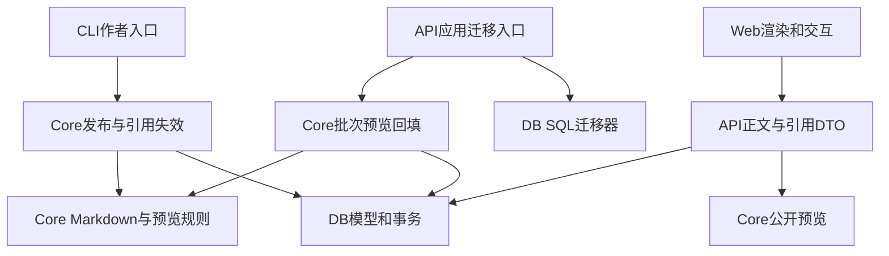

# Architecture Review — PR #21 / Issue #18

结论：未发现阻断合并的架构问题。风险等级 LOW；迁移须按停读写、备份、SQL 与应用回填完整执行的既定部署前提操作。本文为独立只读架构检查，不替代现场浏览器、旧数据迁移和媒体字节验收。

准确审查版本：`79780e15ea8952c05ffe529935a868d539c029f5`。基准为会员分支 `864a0874b562cd62c3598b95c656b37fdeb0985f`，只检查 #18 的代码差异；排除本人实现的 #15 问答、资料、导航和独立代理的既有业务工件。另核对基准 `ab6e744978502e12cc52bbbc6d55634d6b0620b4`。没有修改源码、执行生产写入或新增测试程序。

栈：TypeScript / Node、pnpm workspace、Drizzle / PostgreSQL、Hono API、Next.js / React、remark AST。使用 architecture-review 技能；host typed findings 渲染不可用，采用本文文件行引用。

## 依赖方向与领域职责

数据库包没有反向引用 core 或应用层。`apps/api/src/migrate.ts:4-5` 作为应用编排同时调用 DB SQL 与 core 回填，`packages/db/src/migrate.ts:1-17` 仅持有数据库连接与 Drizzle migrator。`packages/core/src/content-migration.ts:4-9` 依赖 DB/领域 Markdown/缓存事件，没有 HTTP 路由依赖。新增模块未发现跨包循环依赖。

## 核对结果

| 边界 | 结果 | 源码与影响 |
|---|---|---|
| 正式迁移入口 | PASS（静态） | 根 `package.json` 的 db:migrate 改为 API 应用入口；`apps/api/tsup.config.ts` 编译 src/migrate.ts；Docker保留 dist/migrate.js 并注入 MIGRATIONS_FOLDER=/app/drizzle。没有留下仅执行 SQL 就宣布数据回填完成的默认脚本。 |
| SQL与回填故障 | PASS（静态） | `0010_dark_brother_voodoo.sql:21-27` 在旧媒体缺失时拒绝 SQL 迁移；恢复表保留原行和转换版本。`content-migration.ts:13-18` 每批最多200行，单批事务失败回滚；只处理 null 投影，已完成批次可保留，重跑恢复。原主媒体仅在恢复版本仍匹配时注入，不重复插入。 |
| 互斥与资源释放 | PASS（静态） | `apps/api/src/migrate.ts:15-24` 先持发布/GC锁执行 SQL与回填，锁等待有60秒截止；finally释放锁并关闭池和专用连接。锁范围覆盖所有批次。该60秒是发布锁等待界限，不能解释为全部迁移执行时间上限。 |
| 预览版本与权限 | PASS（静态） | `public-preview.ts:5-10` null 投影失败关闭；有效派生版本复用，revision变化后按当前规则重算。`publish.ts:219-222,239-240,273-283` 在同一发布事务计算预览、写版本投影和媒体exposure；`content-migration.ts:41-46` 从原正文生成旧付费预览、从迁移正文生成免费全文并轮换版本。 |
| 直接引用失效 | PASS（静态） | `references.ts:36-44` 校验存在/已发布/非自身；referenced_id保留逻辑身份、target_id删除置空。`:48-61` 最多100个直接引用者，在事务内轮换其revision，并仅携带仍匹配的previewRevision。`publish.ts:318-321`、`apps/cli/src/cache.ts` 下架/删除和 `commands/cache.ts:25-27` SQL修复刷新与目标变更共同提交失效事件，失败可整体回滚。 |
| 一跳读取与媒体门禁 | PASS（静态） | `routes/references.ts:15-23` 通过匿名正文投影读取当前摘要，no-store，不继承引用者权益；summary跳过work指令，避免递归。`routes/post-feed.ts:17-25` 先裁匿名预览并按exposure过滤媒体，再折叠，不用全文生成付费Feed。字节仍走原媒体权限和实时公开图片门禁，引用卡片不创建授予权益的媒体边。 |
| 浏览器资源生命周期 | PASS（静态） | `InlineMedia` 只在用户点击后挂载，一个页面同一时刻一个激活媒体；退出视口和收起卸载。`player.tsx` 卸载清理timer、listener和src；`PostEntry` 请求取消、权限详情与折叠正文分离；Web没有自行授予阅读权益。真实播放/字节由另一代理验收。 |

## 阻断项

无。没有跨层逆向依赖、公开DTO继承引用者权益、引用循环递归读取或把SQL回填失败当作迁移成功的路径。

## 观察与 ADR 一致性

| 文档 | 状态 | 说明 |
|---|---|---|
| ADR-0014 | 一致 | post/article 与Markdown媒体统一；引用持久化保留UUID；一跳摘要、派生投影、直接引用者失效和发布锁符合实现。 |
| ADR-0004/0006 | 一致 | 权益与媒体访问仍由服务端判定，发布和GC互斥，没有把Web展示组件变成权限权威。 |
| docs/post-migration.md | 一致 | 明确SQL已提交而回填中断的恢复方式、旧预览原正文来源和未开放新发布前的回滚窗口；恢复表不是GC活跃引用。 |
| docs/architecture.md §1 | 轻微文字滞后 | 产品边界段仍列“文章、图片、视频、音频”，后文新模型已为post/article。属于文档同步，不阻断代码或迁移。 |

曾提出“textPrefix新增会扩大旧percent预览”的疑点，已撤回。准确 `git diff 864a087 79780e1 -- packages/core/src/preview.ts` 证明基准原已有textPrefix，本次仅增加Feed篇幅限制及块上限。没有据此提出预览算法回退。另阅读独立业务代理的 `migration-exact-comparison.json`：17个旧运行实体保留字段一致，付费percent/marker/full逐字符串一致，关联哈希一致；这是该代理现场证据，不是本架构review重新执行的验收。

## 检查命令与未覆盖范围

实际只读命令：`git rev-parse HEAD`；`git diff --stat 864a087 HEAD`；对指定79780e1/864a087/ab6e744使用 `git show <SHA>:<path>`、`git diff <baseline> <head> -- <path>`；`rg`核对跨包imports；`gh pr view 21 --json headRefOid,url`；读取ADR、架构与迁移说明、Dockerfile以及旧运行迁移对比工件。

UNVERIFIED：本次没有现场中断数据库网络、等待60秒锁超时、杀死迁移进程或执行生产回滚；没有复跑另一代理已负责的浏览器、媒体播放、缓存和真实数据迁移。最终整合 #15 新导航组件后仍应核对准确head与对应构建，不把本只读结论当作部署完成。

## 最终整合版本续审

续审准确源码：`162919403b10760f6dd06be5cab17d255d65cb59`，已整合 main `ab13db42e975adf4fbddb16ca8c660c3bbd0daf5`。保留以上79780e1原始结论与历史观察；本节是追加的最终差异核对。

实际命令：`git diff 79780e1 1629194 -- apps packages docs`；对迁移入口、core全部源码、DB全部迁移/模型、引用/Feed/媒体门禁和CLI失效路径执行限定路径 `git diff --exit-code 79780e1 1629194 -- ...`，exit 0。#18迁移与领域实现没有进一步变化，依赖方向、回填恢复、预览版本carry、引用反向失效和媒体授权结论继续成立。

变化仅为：原样整合 #15 的问答/资料/图片路由范围及身份默认no-store修复；原样增加CollectionNavigation并在ContentView正文后调用；架构§1已同步post/article。限定这些 #15 文件 `git diff --exit-code 17c09e4 1629194 -- ...` 为exit 0。本人实现的 #15 修复不纳入独立评价，业务依据cache_review对exact17c09e4的独立复验；本节仅证明整合没有改写它们。ContentView继续保留post/article共用客户端评论和无标题帖子回退，新增导航不授予邻居作品正文权限。

最终架构结论：无阻断项，LOW；上文架构§1文字滞后已解决。主agent报告此最终源码的typecheck/build PASS，属于主agent工程检查，本续审没有重复执行或扩大为业务验收。剩余UNVERIFIED故障注入范围与原报告一致。
